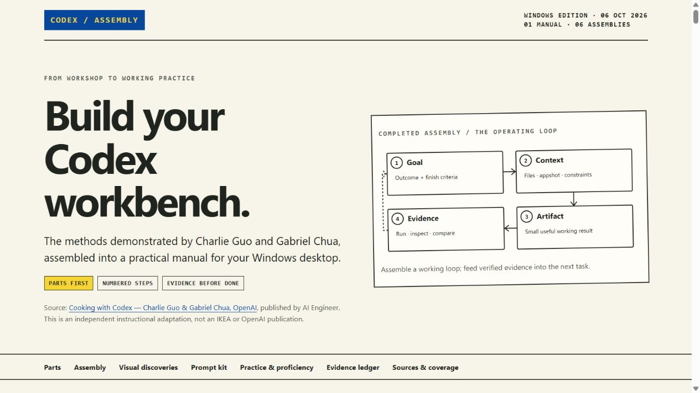

# Cooking with Codex

An independent, evidence-grounded assembly manual for using Codex on Windows, adapted from Charlie Guo and Gabriel Chua’s workshop. The design follows the video’s IKEA-style example: a parts inventory, numbered assembly panels, connection diagrams and checks for the finished result.

**[Open the live manual](https://az9713.github.io/cooking-with-codex/)**

[](https://az9713.github.io/cooking-with-codex/)

## Reference

[Cooking with Codex — Charlie Guo & Gabriel Chua, OpenAI](https://www.youtube.com/watch?v=FwiS44-xyYw&t=25s), published by **AI Engineer**. The video lasts 1:07:23. The page showed an upload date of 5 October 2026; the demonstration refers to 29 June and shows corresponding screen clocks. Treat its UI, model choices and offers as historical demonstrations.

The guide combines the full available auto-generated English transcript (0:18–1:07:03) with targeted direct visual inspection, including 24 saved timestamped samples. It does **not** claim continuous frame-by-frame viewing or an independent full audio pass. The evidence ledger separates visible content, interpretation and unverified outcomes.

## What is included

- Six assemblies: supply context, build and inspect, take action, manage complexity, work over time, and embed the harness.
- Both hosts’ overlapping approaches, adapted to Windows rather than copied from macOS demos.
- Seventeen original reusable prompts, with copy buttons and a manual-copy fallback.
- A scientific replication capstone, milestone contracts and proficiency checks.
- A 24-entry visual evidence ledger, full-video navigation and links to official product documentation.
- Local checklist persistence where browser storage is available, a responsive layout and a print view.

Prompts and diagrams are instructional adaptations, not verbatim host prompts. Reading the guide alone does not establish expert proficiency; its practice checks require observable results.

## Use locally

Open `index.html` in a browser. It embeds its styling, script and diagram excerpt; it needs no installation or build step. External reference links require internet access. Clipboard access and local storage depend on the browser; the prompt text remains available if either is restricted.

For a local HTTP preview, run this from the repository directory:

```sh
python -m http.server 8000 --bind 127.0.0.1
```

Then open `http://127.0.0.1:8000/`.

## Files

| File | Purpose |
| --- | --- |
| `index.html` | Self-contained interactive manual and GitHub Pages entry point |
| `preview.jpg` | Clickable README preview of the guide |
| `source-manifest.json` | Public source references, dates and coverage limits |
| `analysis-ir.json` | Timestamped observations, chapter summaries and adapted prompts |
| `artifact-manifest.json` | Deliverable inventory and source dependencies |
| `check_public.py` | Runnable package, privacy and link checks |
| `.nojekyll` | Serve the static files without a Jekyll build |

## Publication and privacy

GitHub Pages serves the repository root from `main`. The public package excludes raw transcripts, inspection frames, temporary files, private workstation paths, personal profile details and credentials. It retains one clean cropped assembly-diagram excerpt; other demo screenshots are omitted to avoid redistributing account, document or workspace identifiers. Their findings remain in the timestamped ledger. Commit author metadata uses a generic identity rather than a personal name or email.

The intentionally public GitHub account in the repository and Pages URLs identifies the requested publication destination. The hosts’ names remain solely for source attribution. There are no remote fonts, scripts, trackers or analytics, and the HTML uses a restrictive Content Security Policy.

## Validation and limits

Run:

```sh
python check_public.py
```

Checks cover the public file allowlist, local links and anchors, expected guide content, credential/path patterns, embedded image metadata, remote dependencies and the script’s CSP hash. The guide was also inspected in a browser at desktop and narrow-screen sizes; prompt disclosure and checklist behavior were exercised.

The demonstrated translation quality, production authentication, complete Slack-to-PR pipeline and cross-client synchronization were not independently established. Multi-hour durations are source reports, not performance promises. Recheck current client capabilities, configuration schemas, shortcuts and execution environments before applying a workflow.

This is an independent educational project. It is not an official OpenAI or IKEA publication. The source video and excerpt remain attributable to their respective creators; no ownership of them is asserted.
